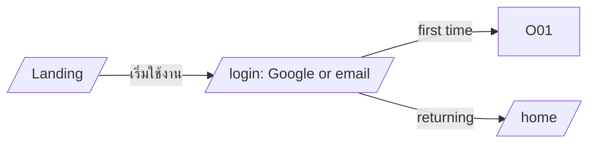
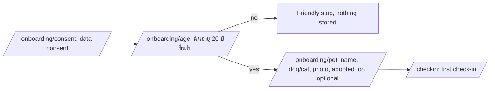
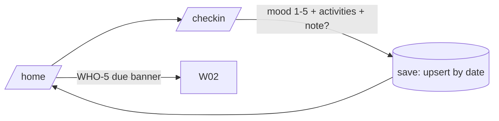
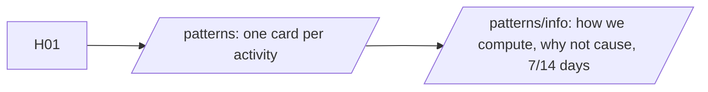
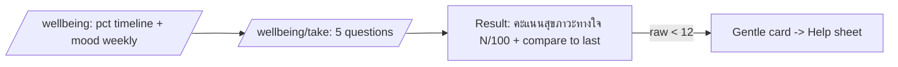
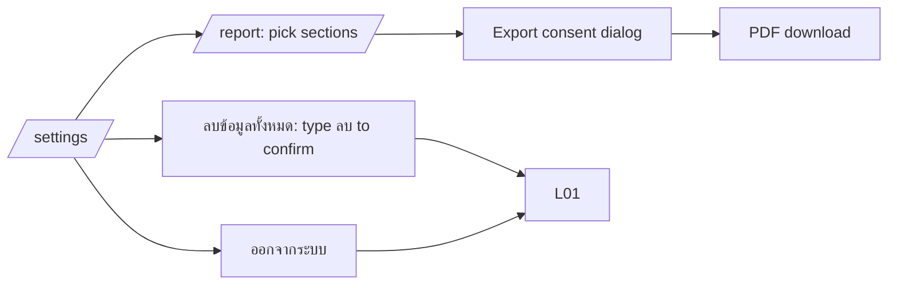

# USER_FLOW.md — screens, routes, phases

## Flow 0 — Landing + auth (Phase 2)

## Flow 1 — Onboarding (Phase 3)

## Flow 2 — Daily check-in (Phase 3)

Check-in screen order: pet photo card → mood (5 faces) → "วันนี้กับน้อง" joy chips → "ภาระวันนี้" burden chips → note (collapsed) → บันทึก.
Editing today again overwrites today (upsert).

## Flow 3 — Personal Patterns (Phase 4)

Sort: non-insufficient cards first (by |diff| desc), then insufficient (by fewest days needed).

## Flow 4 — WHO-5 + timeline (Phase 4)

## Flow 5 — Help (Phase 5, global)
Floating "ต้องการคนรับฟัง" on every signed-in screen → help sheet (SAFETY_PRIVACY.md). Gentle cards also open it.

## Flow 6 — Report + settings (Phase 5)

## Flow 7 — Pets & memories (Phase 5, nice)
`/pets`: current pet card (since adoption: N days) + "ความทรงจำ" list of past pets (name, species, period, feeling 1–5, tags, memory note). Copy: "ข้อมูลส่วนนี้เป็นความทรงจำ ไม่นำไปคำนวณรูปแบบ".

## Screen → route → phase
| Screen | Route | Phase |
|---|---|---|
| Landing | `/` | 2 |
| Login | `/login`, `/auth/callback` | 2 |
| Consent / Age / Pet | `/onboarding/consent`, `/onboarding/age`, `/onboarding/pet` | 3 |
| Home | `/home` | 3 |
| Check-in | `/checkin` | 3 |
| Patterns + info | `/patterns`, `/patterns/info` | 4 |
| Well-being timeline + WHO-5 | `/wellbeing`, `/wellbeing/take` | 4 |
| Help sheet | global component | 5 |
| Pets & memories | `/pets` | 5 |
| Report | `/report` | 5 |
| Settings | `/settings` | 5 |
| Learn | `/learn` | 6 |
| AI weekly summary | card on `/home` | 6 (optional) |
